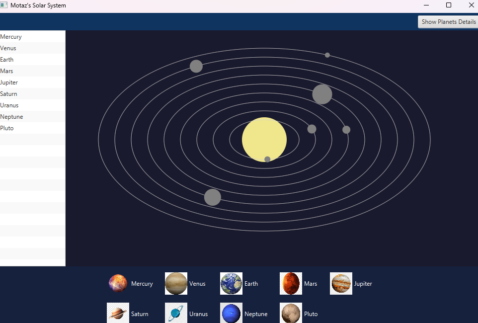

# solar-system-javafx

Final project for A JavaFX simulation of the solar system.

#What it does
- Sun and planets moving on elliptical orbits (PathTransition)
- Click a planet icon to add it to its orbit
- ListView with the planet names, shows an error if the planet is not added yet
- Sound effect for each planet
- Table with the planets data (mass, distance, speed)
- Right click menu to stop or start all animations

# Built with
Java, JavaFX

#Note
The planet images and sound files are not included in this repo, so the project will not run without them.
